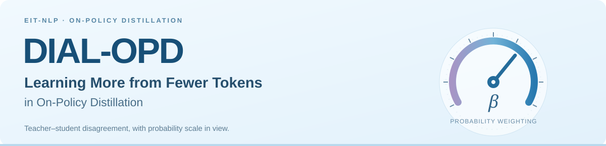
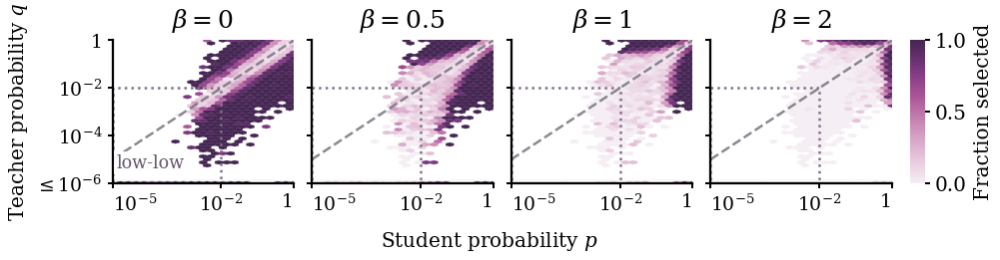
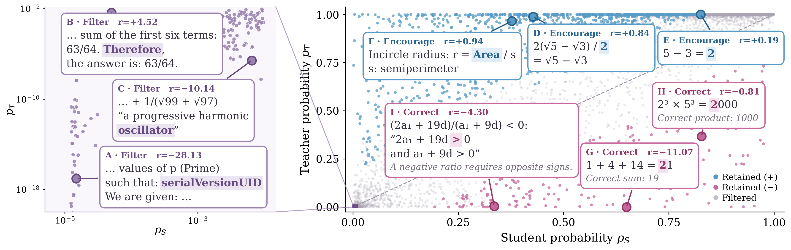

<p align="center">
  
</p>

<p align="center">
  Anhao Zhao · Haoran Xin · Junlong Tong · Yingqi Fan<br>
  Xuan Lu · Ping Nie · Wenjie Li · Xiaoyu Shen
</p>

<p align="center">
  <a href="https://arxiv.org/abs/2610.11659"></a>
  <a href="https://github.com/EIT-NLP"></a>
</p>

<p align="center">
  <a href="#overview">Overview</a> ·
  <a href="#results">Results</a> ·
  <a href="#quick-start">Quick start</a> ·
  <a href="#what-does-dial-opd-select">Token selection</a> ·
  <a href="#citation">Citation</a>
</p>

## Overview

**More supervision does not necessarily improve OPD.** Even random token selection can outperform full-token training. DIAL-OPD selects tokens using both teacher–student disagreement and the probability scale at which it occurs, reducing the priority of tokens that both models consider unlikely.

<table align="center">
<tr>
<th align="center">Less supervision</th>
<th align="center">Stronger reasoning</th>
<th align="center">Better token selection</th>
</tr>
<tr>
<td align="center"><strong>40% tokens · +5.25 pp</strong><br><sub>Mean accuracy over Vanilla OPD</sub></td>
<td align="center"><strong>2× AIME25 Pass@16</strong><br><sub>13.33% → 26.67%</sub></td>
<td align="center"><strong>Up to 18% relative gain</strong><br><sub>Mean accuracy over the strongest selection baseline</sub></td>
</tr>
</table>

<p align="center"><sub>Paper results across 4 teacher–student pairs, 7 math benchmarks, and 9 baselines. Highlights use different settings; comparisons are detailed below.</sub></p>

### A dial between relative and absolute disagreement

A large log-ratio reward can arise even when **both teacher and student assign negligible probability** to a token. These *low-low tokens* can dominate the reward magnitude of the selected subset and hinder learning. DIAL-OPD combines reward magnitude with the **logarithmic mean** of the two probabilities:

$$
s_{\beta,t}=L(p_t,q_t)^\beta\left|\log\frac{q_t}{p_t}\right|,
\qquad
L(p,q)=\begin{cases}\dfrac{q-p}{\log q-\log p},&p\ne q,\\p,&p=q.\end{cases}
$$

Here, $p_t$ and $q_t$ are the student and teacher probabilities of the sampled token. Within each response, the highest-scoring tokens are retained for training.

| Parameter | What it controls |
| :--- | :--- |
| `keep_ratio` ($\rho$) | How many response tokens contribute to the loss |
| `score_beta` ($\beta$) | How strongly probability scale influences selection |

At $\beta=0$, selection uses reward magnitude alone. At $\beta=1$, it uses the absolute probability gap $|q_t-p_t|$. Larger values increase probability weighting. **The original signed OPD reward is preserved**; selection changes which positions contribute to training, while every generated token remains in context.

## Results

The [paper](https://arxiv.org/abs/2610.11659) evaluates Qwen3 teachers (4B / 8B) and students (0.6B / 1.7B). Below are selected results; **pp** denotes percentage points. Model pairs are written as teacher → student.

| Comparison | Setting | Result |
| :--- | :--- | :--- |
| **vs. full-token Vanilla OPD** | 4B → 0.6B · retain 40% · $\beta=1$ | **+5.25 pp** mean accuracy |
| **vs. the strongest full-token variant** | 4B → 1.7B · retain 40% · $\beta=1$ | **+1.24 pp** mean accuracy over PowerOPD |
| **vs. full-token Vanilla OPD on AIME25** | 8B → 1.7B · retain 40% · $\beta=1.2$ | **13.33% → 26.67%** Pass@16 |
| **vs. the strongest token-selection baseline** | 4B → 1.7B · retain 20% · $\beta=1$ | **+5.23 pp** mean accuracy over CC-OPD |

*Effective supervision allocation can outweigh teacher scaling.* With 40% retention and $\beta=1$, a 4B teacher exceeds the strongest full-token reference using an 8B teacher by **0.95 pp** and **1.76 pp** in mean accuracy for the 0.6B and 1.7B students, respectively.

## Quick start

### 1. Set up the environment

Use **Linux and Python 3.10**, with PyTorch 2.10.0 (CUDA 12.8), vLLM 0.19.1, and Transformers 5.14.1.

```bash
git clone https://github.com/EIT-NLP/DIAL-OPD
cd DIAL-OPD
python3.10 -m venv .venv
source .venv/bin/activate
python -m pip install -r requirements-gpu.txt
python scripts/install_trl.py
export PYTHONPATH="$PWD${PYTHONPATH:+:$PYTHONPATH}"
```

The TRL installer verifies a pinned source archive and installs it inside your active venv. See the [running guide](docs/RUNNING.md#installation) for GPU UUID compatibility and environment details.

### 2. Download models and data

```bash
python scripts/download_assets.py
```

This prepares Qwen3-0.6B-Base, Qwen3-4B, DeepScaleR training data, and the MATH test set. See [data preparation](docs/RUNNING.md#prepare-models-and-data) for custom data and tokenizer requirements.

### 3. Train DIAL-OPD

Set the model/data paths, `score_beta`, `keep_ratio`, and `output_dir` in [train_qwen3_06b.json](configs/train_qwen3_06b.json), then run:

```bash
export CUDA_VISIBLE_DEVICES=0  # choose your allocated GPU
export VLLM_ENABLE_V1_MULTIPROCESSING=0
python -m dial_opd.train --config configs/train_qwen3_06b.json
```

The configuration trains for 800 steps and saves the final student checkpoint. Use a new `output_dir` for each run. For a three-step example, use [smoke_vllm.json](configs/smoke_vllm.json); see the [running guide](docs/RUNNING.md#run-a-small-training-test) for outputs and configuration details.

## What does DIAL-OPD select?

### Probability scale changes which disagreements matter

On the same 128 DeepScaleR responses at 20% retention, increasing $\beta$ from 0 to 1 reduces the low-low share among selected tokens from **8.26% to 0.29%**. At $\beta=2$, the share falls further to 0.02%, but selection also suppresses tokens supported by only one model. Together with the training results, this suggests a balance between suppressing low-low tokens and preserving useful supervision.

<p align="center">
  
</p>

### Large rewards need not identify useful reasoning supervision

The examples below show DIAL-OPD filtering high-reward tokens with limited reasoning value while retaining signals that encourage correct reasoning or correct errors. Blue and pink mark retained tokens with positive and negative rewards; the left panel zooms into the low-low region.

<p align="center">
  
</p>

## Documentation

See the [running guide](docs/RUNNING.md) for installation, custom data, configuration options, tests, and troubleshooting.

<details>
<summary><strong>Repository structure</strong></summary>

```text
dial_opd/    Token selection, signed OPD loss, rollouts, evaluation
configs/     Smoke test and training configurations
scripts/     Runtime installation, model/data download, diagnostics
tests/       Selector and trainer checks
docs/        Installation and usage guide
assets/      README banner and paper figures
```

The training framework builds on [PowerOPD](https://github.com/EIT-NLP/PowerOPD) and [Hugging Face TRL](https://github.com/huggingface/trl). The pinned TRL runtime retains its Apache-2.0 license and file-level notices.

</details>

## Citation

If you find this work useful, please cite:

```bibtex
@misc{zhao2026dialopd,
  title={DIAL-OPD: Learning More from Fewer Tokens in On-Policy Distillation},
  author={Anhao Zhao and Haoran Xin and Junlong Tong and Yingqi Fan and
          Xuan Lu and Ping Nie and Wenjie Li and Xiaoyu Shen},
  year={2026},
  eprint={2610.11659},
  archivePrefix={arXiv},
  primaryClass={cs.CL},
  url={https://arxiv.org/abs/2610.11659}
}
```

## Contact

Questions and feedback are welcome through [GitHub Issues](https://github.com/EIT-NLP/DIAL-OPD/issues), or contact [Anhao Zhao](mailto:anhao.zhao@connect.polyu.hk) and [Xiaoyu Shen](mailto:xyshen@eitech.edu.cn).
